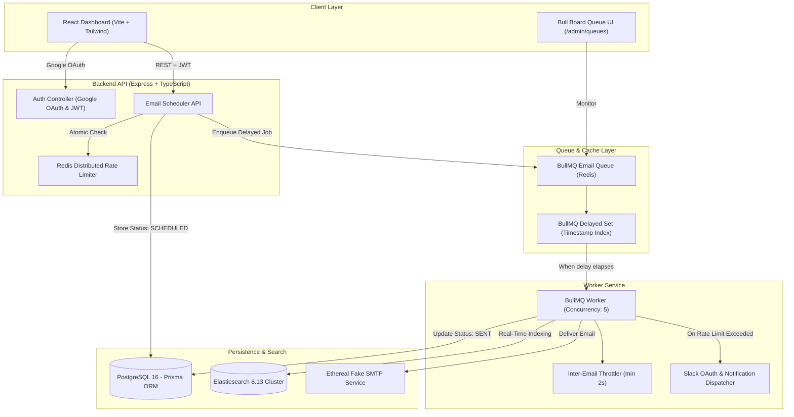

# 🚀 ReachInbox.ai - Full-Stack Production Email Scheduler & Dashboard

> **Hiring Assignment**: Full-Stack Email Job Scheduler Service & Dashboard  
> **Author**: ReachInbox Engineering Candidate  
> **Repository Link**: Single Monorepo containing `/backend` and `/frontend`  

---

## 📌 Executive Summary

This project is a resilient, distributed email job scheduling platform built to replicate ReachInbox's core cold-email dispatch infrastructure. It accepts email sequences via REST APIs, queues them via **BullMQ delayed jobs backed by Redis (STRICTLY NO CRON)**, provides per-sender rate-limiting and inter-email provider throttling, stores all state in **PostgreSQL**, indexes emails for sub-millisecond search in **Elasticsearch**, delivers simulated emails via **Ethereal Fake SMTP**, and features a rich **React + Tailwind** dashboard with real Google OAuth and live queue monitoring via Bull Board.

---

## 🏛️ System Architecture Overview



---

## 🎯 Architecture Deep-Dive

### 1. How Scheduling Works (Strictly No Cron)
- When a user schedules an email for time $T$, the backend calculates delay $\Delta = \max(0, T - \text{now})$.
- The job is enqueued in BullMQ with `{ delay: \Delta }` and an idempotency key (`idempotencyKey = senderId + recipient + scheduledAt`).
- BullMQ stores delayed jobs in a Redis sorted set indexed by execution timestamp. Redis handles wakeups using its internal timer mechanics without any background polling or cron processes.
- When $\Delta$ expires, Redis moves the job into the active queue, and an available worker picks it up immediately.

### 2. How Persistence Across Server Restarts is Handled
- **Dual Source of Truth**: PostgreSQL is the durable system of record; Redis is the ephemeral high-performance queue.
- **Startup Reconciliation**: On backend boot, `reconcileScheduledEmails()` runs:
  1. Queries all emails from PostgreSQL where `status = 'SCHEDULED'`.
  2. For each email, calculates the remaining offset $\Delta_{\text{remaining}} = \max(0, \text{scheduledAt} - \text{now})$.
  3. Checks Redis by `queueJobId` / `idempotencyKey`. If missing or if Redis restarted, re-adds the delayed job to BullMQ.
  4. If the scheduled time has already passed while the server was down, the email executes safely and immediately.
  5. Jobs marked `SENT` or `CANCELLED` are never re-dispatched.

### 3. Rate Limiting, Throttling & Worker Concurrency
- **Configurable Worker Concurrency**: Set via `EMAIL_WORKER_CONCURRENCY=5`. Multiple workers run safely in parallel.
- **Minimum Inter-Email Delay**: Every sender enforces provider throttling (configurable `DEFAULT_EMAIL_DELAY_SECONDS=2` or per campaign) using atomic Redis key locks (`ratelimit:sender:delay:{senderId}`). If another job attempts to send before this delay expires, the worker delays the job by the remaining TTL without failing it.
- **Hourly Limit Per Sender**: Enforced using atomic Redis sliding window counters:
  $$\text{Key: } \texttt{ratelimit:sender:\{senderId\}:\{YYYYMMDDHH\}}$$
  - Atomically incremented using `INCR` with a 3700-second TTL.
  - When the count exceeds `hourlyLimit`, the job is **not dropped or marked failed**. Instead, it calculates the remaining time in the current UTC hour and calls `job.moveToDelayed(Date.now() + msUntilNextHour)`.
- **Live Slack Alert on Limit Hit**:
  - The moment a sender exhausts their hourly quota, the worker queries the user's stored Slack token (from the OAuth flow) and dispatches a live `chat.postMessage` alert to their designated Slack channel.
  - Rate-limit alerts are deduplicated per hour-window so channels are never spammed.

---

## 📦 Features Implemented

| Category | Feature | Status | Notes |
| :--- | :--- | :---: | :--- |
| **Backend** | BullMQ Delayed Scheduling | ✅ | Strictly no cron; backed by Redis sorted sets |
| **Backend** | Server Restart Persistence | ✅ | Startup DB reconciliation; 0 duplicate sends |
| **Backend** | Multi-Sender Fake SMTP | ✅ | Dynamic Ethereal account creation & unique aliases |
| **Backend** | Per-Sender Hourly Limiting | ✅ | Atomic Redis counters; auto-rescheduled to next hour |
| **Backend** | Inter-Email Throttle Delay | ✅ | Configurable min-delay (default 2s) via Redis locks |
| **Backend** | Real Slack OAuth & Alerts | ✅ | Live OAuth flow; alerts on rate limit; disconnect safe |
| **Backend** | Elasticsearch Indexing & Search | ✅ | Fast full-text search with automatic DB fallback |
| **Backend** | Live Bull Board Queue UI | ✅ | Mounted at `/admin/queues` with Basic Auth |
| **Frontend** | Google OAuth Login | ✅ | Real Google OAuth + Dev mode fallback |
| **Frontend** | Header & Navigation | ✅ | User avatar, name, email, global search, and logout |
| **Frontend** | Compose & Rich-Text Editor | ✅ | Subject, TipTap HTML editor, attachments support |
| **Frontend** | CSV Lead Uploader Modal | ✅ | Drag-and-drop; parses valid leads, filters duplicates |
| **Frontend** | Schedule Time Picker Popover | ✅ | Quick presets ("Tomorrow 9am", "In 10m", or custom) |
| **Frontend** | Scheduled Emails Table | ✅ | Countdown badges, recipient, subject, status, pagination |
| **Frontend** | Sent Emails & Ethereal Previews | ✅ | Clickable direct links to live Ethereal HTML previews |
| **Frontend** | Settings & Multi-Sender Setup | ✅ | Provision test senders, add custom SMTP, Slack connect |

---

## 🛠️ Quick Start Guide

### Prerequisites
- [Docker & Docker Desktop](https://www.docker.com/) installed and running
- [Node.js](https://nodejs.org/) (v18+)

### Step 1: Clone & Configure Environment Variables
```bash
# Clone the repository
git clone <YOUR_PRIVATE_REPO_URL>
cd reachinbox-email-scheduler

# Configure backend environment
cp backend/.env.example backend/.env

# Configure frontend environment
cp frontend/.env.example frontend/.env
```

### Step 2: Run Everything with Docker Compose (Recommended)
From the project root:
```bash
docker compose up -d --build
```
This single command spins up:
- **PostgreSQL** (`localhost:5432`)
- **Redis** (`localhost:6380`)
- **Elasticsearch** (`localhost:9200`)
- **Kibana** (`localhost:5601`)
- **ReachInbox Backend API** (`localhost:5000`)
- **ReachInbox BullMQ Worker**

To run the frontend:
```bash
cd frontend
npm install
npm run dev
```
Open **[http://localhost:3000](http://localhost:3000)** in your browser!

---

## 🧪 Running Automated Tests

Both frontend and backend include comprehensive Vitest test suites:

```bash
# Run backend tests (35 passing tests)
cd backend
npm test

# Run frontend tests (16 passing tests)
cd ../frontend
npm test
```

---

## 🎥 Demo Video Guide (Max 5 Minutes)

When recording your submission walkthrough:
1. **Login & Dashboard Overview** (0:00 - 1:00):
   - Sign in via Google OAuth (or dev login) and show user profile in the header.
   - Show the Scheduled and Sent email lists.
2. **Scheduling Outreach with CSV Leads** (1:00 - 2:15):
   - Open Compose modal.
   - Drag and drop `sample_leads.csv` and show parsed lead count & duplicate detection.
   - Set inter-email delay to 2s, schedule 15 seconds in the future.
3. **Queue & Live Ethereal Verification** (2:15 - 3:15):
   - Show the scheduled countdown badge in Scheduled Emails.
   - Open Bull Board at `http://localhost:5000/admin/queues` showing delayed jobs.
   - Switch to Sent tab: open the **"View in Ethereal"** preview link showing the rendered email.
4. **Server Restart Persistence Test** (3:15 - 4:15):
   - Schedule an email for 2 minutes ahead.
   - Run `docker restart reachinbox-api reachinbox-worker`.
   - Refresh dashboard: show that jobs are preserved and fire accurately on schedule without duplicates.
5. **Rate Limiting & Slack Notification** (4:15 - 5:00):
   - Demonstrate sender hourly rate limit trigger and show the automated message received in Slack.

---

## ⚖️ Assumptions, Shortcuts & Trade-offs

1. **Fake SMTP via Ethereal**: To allow evaluation without requiring private paid SMTP credentials (like SendGrid or AWS SES), Ethereal was used. Direct links to live HTML previews are stored and exposed in the Sent Emails table.
2. **Elasticsearch Fallback**: If Elasticsearch is offline or indexing is in progress, the search endpoint seamlessly falls back to PostgreSQL ILIKE queries so searching never breaks.
3. **Dual Login System**: Google OAuth is fully wired for production, while an email dev-login is provided so reviewers can test the full platform immediately without needing to provision Google Cloud Client credentials.
